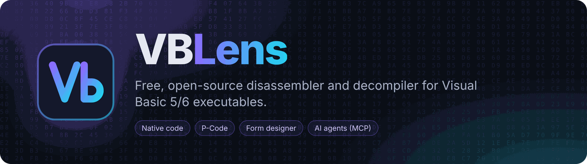
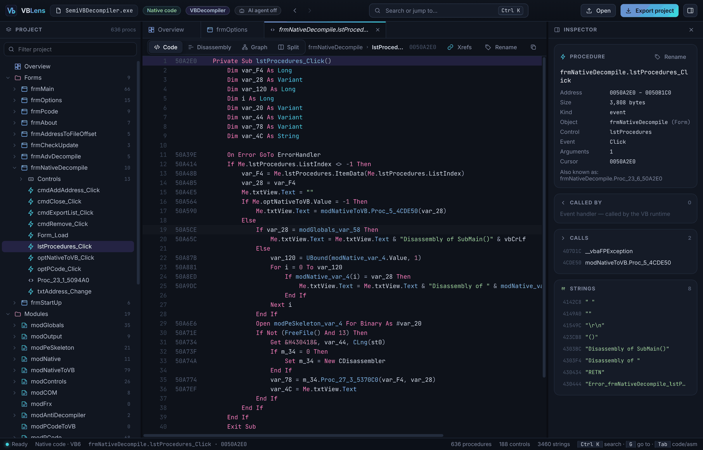
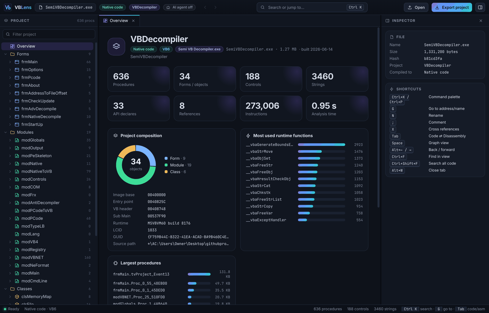
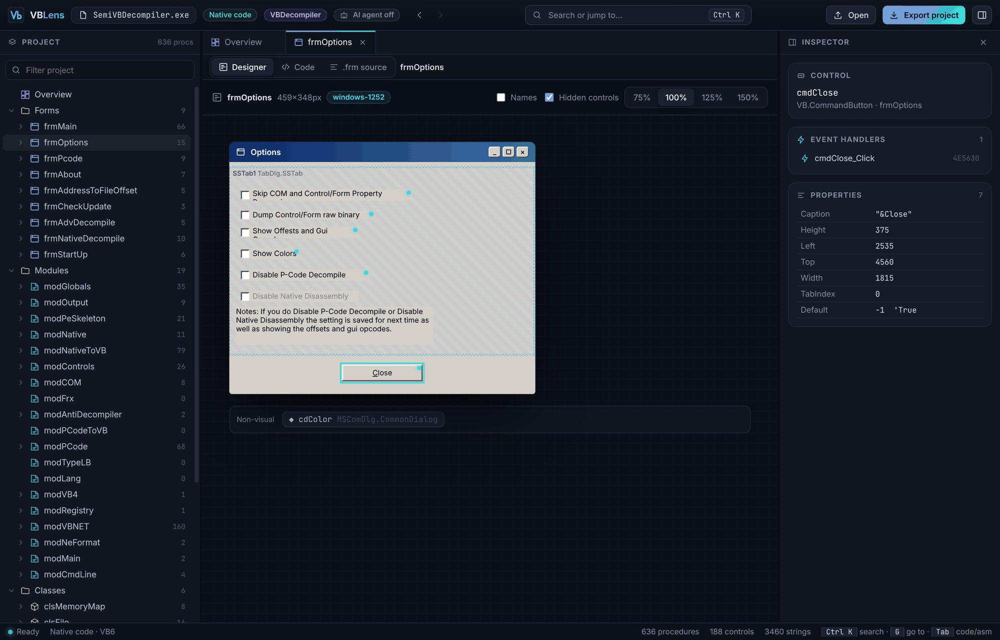
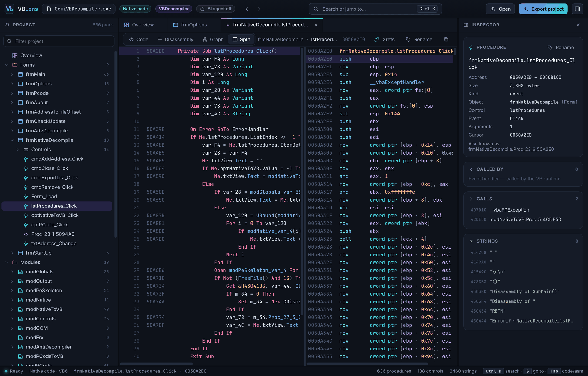
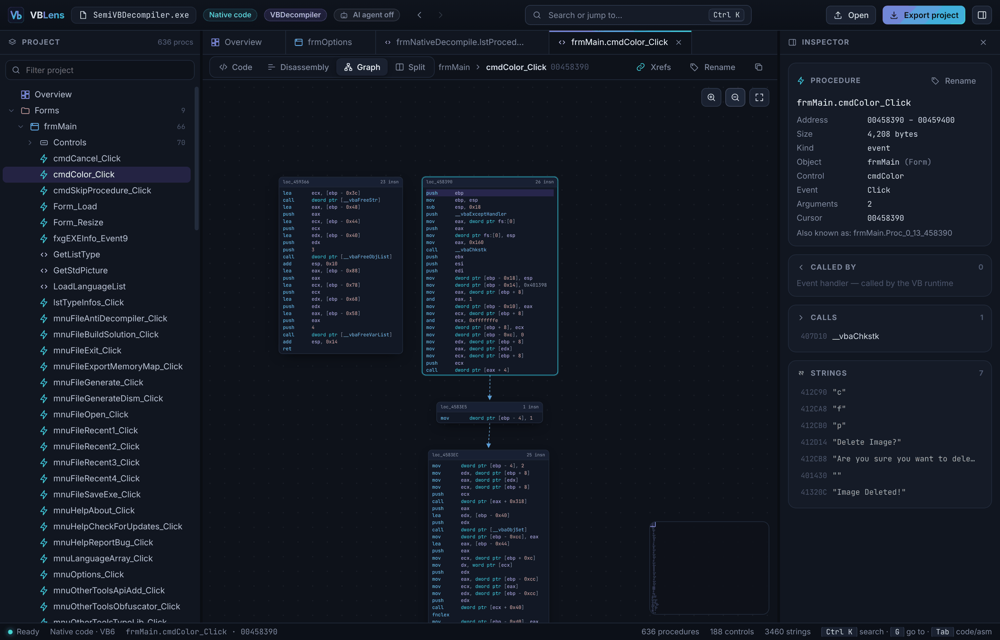
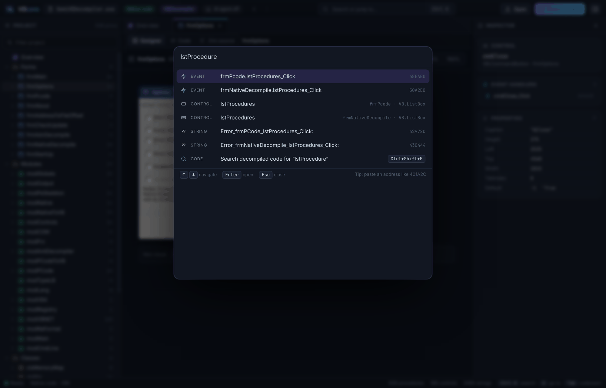
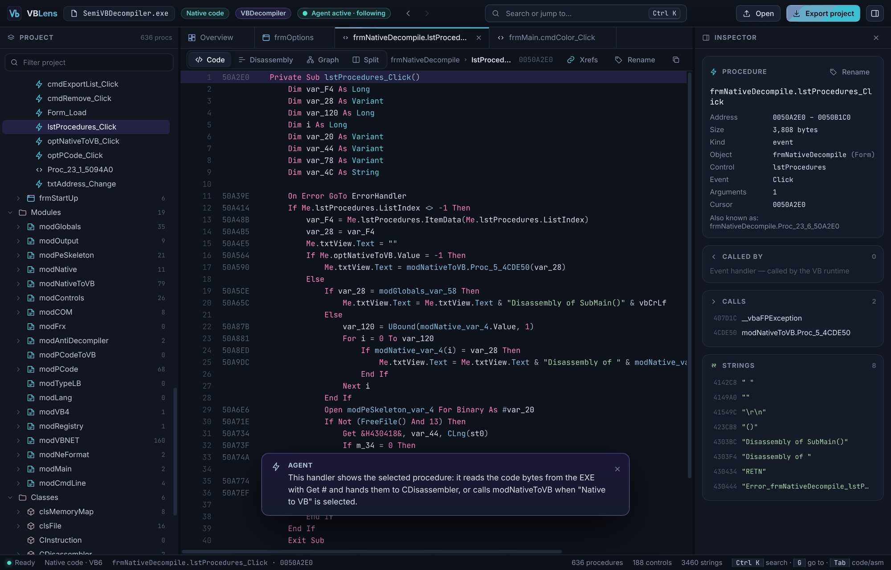
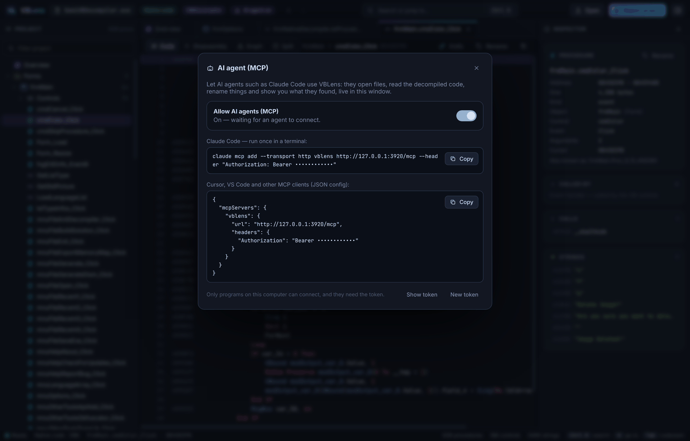

<div align="center">



<br>

**Open a compiled VB5/VB6 `.exe`, `.dll` or `.ocx` and get back its forms, controls, events and Visual Basic source.<br>Native code and P-Code. Runs on your computer. Free, with no editions or keys. Lets AI agents work alongside you.**

<br>

[](https://github.com/SoWhatNaniv/VBLens/releases/latest)
[](LICENSE)
[](#-ai-agents-mcp)

[](https://github.com/SoWhatNaniv/VBLens/actions/workflows/ci.yml)


[](https://github.com/SoWhatNaniv/VBLens/stargazers)

[**Download**](#-download) · [**Features**](#-features) · [**AI agents**](#-ai-agents-mcp) · [**Shortcuts**](#%EF%B8%8F-keyboard) · [**Build**](#%EF%B8%8F-build-from-source)

<br>



</div>

<br>

## ✨ Why VBLens

Visual Basic 6 is long dead, but its executables aren't. They run line-of-business software, old installers and a steady stream of malware. Most other VB decompilers are closed source, cost money, or stopped being updated years ago. VBLens is a modern, open alternative:

- 🔍 **Decompiles native code *and* P-Code** into structured VB: `If/ElseIf`, `Select Case`, `For/Next`, `Do/Loop`, `Exit For`, `And`/`Or` conditions, `On Error GoTo`, and calls to the VB runtime, COM and APIs. Locals are declared with their recovered types.
- 🖼️ **Rebuilds the forms** and draws them as they looked, with menus, control arrays, fonts, pictures and right-to-left text.
- 🧭 **IDA-style workspace**: code, disassembly, graph and split views, all linked. Cross references, rename, comments and a command palette for everything.
- 🤖 **Built for AI agents**: an MCP server lets Claude Code, Cursor and other agents open the same file, read the code and show you what they find in your window.
- 🛡️ **Safe for malware**: files are only parsed, never loaded or run, and never leave your machine.
- 📦 **Exports a project you can open** (`.vbp`, `.frm`, `.bas`, `.cls`, `.ctl` plus extracted resources).

## 📥 Download

1. Download **`VBLens-Windows-x64-<version>.zip`** from the [latest release](https://github.com/SoWhatNaniv/VBLens/releases/latest).
2. Unzip it anywhere and run **`VBLens\VBLens.exe`**. Nothing to install.
3. Drag a VB5/VB6 `.exe`, `.dll` or `.ocx` onto the window, or onto `VBLens.exe`.

> [!NOTE]
> The build isn't code-signed yet, so Windows SmartScreen may show *"Windows protected your PC"* the first time. Click **More info → Run anyway**, or [build it yourself](#%EF%B8%8F-build-from-source).

Settings and logs are kept in `%APPDATA%\VBLens`. A Linux build can be made from source (`npm run dist:linux`).

## 🧩 Features

<table>
<tr>
<td width="50%" valign="top">

### Project recovery
Parses the VB5!/VB6 header, project info, object table, method tables, public variables, API `Declare`s, referenced ActiveX components and type libraries, then rebuilds the full project tree: forms, MDI forms, modules, classes, user controls and property pages.

</td>
<td width="50%"></td>
</tr>
<tr>
<td width="50%"></td>
<td width="50%" valign="top">

### Form designer
Decodes the binary form streams and draws every form in classic Windows style. That includes all intrinsic controls, menus with shortcuts, control arrays, ActiveX controls, fonts and charsets (including Hebrew and Arabic right-to-left text) and pictures. Click a control to see its properties and events. Double-click to jump to its handler.

</td>
</tr>
<tr>
<td width="50%" valign="top">

### Native code decompiler
- An IA-32 disassembler that matches Capstone instruction for instruction on 700k+ VB instructions.
- Symbolic execution that understands ~400 VB runtime functions (`__vba*`, `rtc*`), COM vtable calls, late binding, variants, arrays and error handling.
- Recovers return values, control arrays (`Me.Text1(i)`), string literals, and integer division by constants.
- Rebuilds structured control flow: `And`/`Or` conditions, `Select Case`, guard clauses, `Exit For`/`Exit Do`. More than 90% of procedures come out with no `GoTo` at all.
- Declares every local with a recovered type (`String`, `Long`, `Boolean`, `Date`, control classes, `New` objects). Win32 structures passed to APIs (`STARTUPINFO`, `PROCESS_INFORMATION`, `CONTEXT`, `PROCESSENTRY32`...) are named too. For counters become `i`, `j`, `k`.

</td>
<td width="50%"></td>
</tr>
<tr>
<td width="50%"></td>
<td width="50%" valign="top">

### P-Code, graphs & more
- **P-Code decompiler**: disassembles all six opcode tables and turns the stack machine into structured VB with typed functions and `Property Get/Let`.
- **Control-flow graph** with pan, zoom and a minimap.
- **Strings, imports, API declares, references** and a **hex view** with a data inspector.
- **Common ActiveX controls built in**: Winsock, Inet, CommonDialog, RichTextBox, MSComm, MSComctl (TreeView, ListView, Toolbar…), FlexGrid, SSTab, MCI and more. Their events, properties and methods are named without any `.ocx` files. For third-party controls, load the `.ocx`/`.tlb`.

</td>
</tr>
<tr>
<td width="50%" valign="top">

### Keyboard-first workspace
A command palette (`Ctrl+K`) jumps to any procedure, form, control, string or address. `Ctrl+Shift+F` searches the decompiled code of the whole project. Renames and comments are saved per file.

</td>
<td width="50%"></td>
</tr>
</table>

## 🤖 AI agents (MCP)

VBLens has a built-in [Model Context Protocol](https://modelcontextprotocol.io) server. Turn it on and an AI agent works on **the same files as your window**. You watch what it opens, it points you to code with notes, and it can see what you're looking at.

<div align="center"></div>

**Setup (one time):**

1. In VBLens, click **AI agent** in the top bar, open **AI agent settings** and turn on **Allow AI agents (MCP)**.
2. Copy the command it shows and run it in a terminal. For Claude Code:
   ```bash
   claude mcp add --transport http vblens http://127.0.0.1:3920/mcp --header "Authorization: Bearer <token from the app>"
   ```
   For Cursor, VS Code and other clients, copy the JSON config shown below the command.
3. Ask your agent something like *"open the file in VBLens and find where it talks to the network"*.

<details>
<summary><b>What the agent can do (28 tools)</b></summary>

<br>

| Area | Tools |
|---|---|
| Files | `vb_open_file`, `vb_list_files`, `vb_close_file`, `vb_get_overview`, `vb_load_type_library` |
| Code | `vb_decompile`, `vb_decompile_object`, `vb_disassemble`, `vb_get_cfg`, `vb_get_procedure_info`, `vb_search_code` |
| Navigation | `vb_list_objects`, `vb_list_procedures`, `vb_get_xrefs`, `vb_resolve_address`, `vb_search`, `vb_get_form` |
| Data | `vb_list_strings`, `vb_list_imports`, `vb_list_api_declares`, `vb_read_bytes` |
| Edits | `vb_rename`, `vb_set_comment`, `vb_export_project` |
| Your window | `vb_app_status`, `vb_open_app`, `vb_get_user_view`, `vb_show_in_app` |

Full reference, standalone/headless mode and options: [mcp/README.md](mcp/README.md).

</details>

> [!TIP]
> Agents can only connect while the switch is on, only from the same computer, and only with the token. **New token** disconnects every agent set up with the old one.

<div align="center"></div>

## ⌨️ Keyboard

| Key | Action | | Key | Action |
|---|---|---|---|---|
| `Ctrl+K` / `Ctrl+P` | Command palette | | `X` | Cross references |
| `G` | Go to address or name | | `N` | Rename |
| `Tab` | Code ⇄ disassembly | | `;` | Comment at cursor |
| `Space` | Graph view | | `Alt+←` / `Alt+→` | Back / forward |
| `Ctrl+F` | Find in view | | `Ctrl+Shift+F` | Search all decompiled code |
| `I` | Toggle inspector | | `Alt+W` | Close tab |

## 🛠️ Build from source

Requires **Node.js 20.3+**.

```bash
git clone https://github.com/SoWhatNaniv/VBLens.git
cd VBLens
npm install
npm run desktop      # build and run the desktop app
```

| Command | What it does |
|---|---|
| `npm run dist:win` | Windows app → `release/VBLens-Windows-x64-<version>.zip` (works from Linux too) |
| `npm run dist:linux` | Linux app → `release/VBLens-linux-x64/` |
| `npm run build` | The app as one self-contained `dist/index.html` (also runs in a browser) |
| `npm run build:mcp` | The engine / MCP server with the app embedded → `dist-mcp/vblens-mcp.mjs` |
| `npm run dev` | Vite development server |
| `npm test` | Session smoke test (`VB_SAMPLE=path/to/file.exe`) |
| `npm run test:mcp` | MCP self-check against the built server (`VB_SAMPLE=...`) |
| `npx tsx tests/decomp.ts Form1.Command1_Click` | Decompile one procedure on the command line |

End-to-end browser and desktop tests are in [tests/e2e](tests/e2e/README.md).

<details>
<summary><b>Project layout</b></summary>

```
src/core/pe/          PE image reader (sections, imports, resources)
src/core/vb/          VB structures and binary form parser
src/core/x86/         IA-32 decoder and formatter
src/core/analysis/    procedure discovery, attribution, xrefs, strings, CFG
src/core/decompiler/  native decompiler: IR, VB runtime model, symbolic executor, structurer
src/core/pcode/       P-Code discovery, disassembler, stack-machine decompiler, structurer
src/core/typelib/     MSFT type library reader (.ocx / .tlb / .olb)
src/core/session.ts   everything the UI asks for
src/ui/               React UI
mcp/                  engine / MCP server: tools, live link to the app, settings
desktop/              Electron main process, icons, packaging
tests/                command-line checks against real binaries, e2e tests
```

</details>

## ⚠️ Limitations

Decompiling compiled VB always loses some information. Local variable names, comments and constant names aren't stored in the binary, so locals show as `var_XX` and unknown parameters as `arg_XX`. Use rename (`N`) on procedures and globals to name them. Members of third-party ActiveX controls stay as `Method_XX` / `DispID_XX` until you load the control's type library. A few procedures still use `GoTo` where the compiled code really jumps across blocks (shared tails of loops, for example). Recovered types are inferred from how a variable is used, so a variable nothing tells anything about is declared `As Variant`. The P-Code opcode table comes from community research, so a few rarely used opcodes are shown as comments.

## 🤝 Contributing

Bug reports and pull requests are welcome. If a file decompiles badly, please [open an issue](https://github.com/SoWhatNaniv/VBLens/issues) with the procedure name and what you expected. Attach the binary only if you're allowed to share it. Before sending a PR, run `npm run typecheck` and `npm test`.

## 📜 License

[MIT](LICENSE) © Niv ([@SoWhatNaniv](https://github.com/SoWhatNaniv)) and contributors.

The P-Code opcode table is derived from the Apache-2.0 [`visualbasic`](https://crates.io/crates/visualbasic) crate. Other bundled components are listed in [THIRD_PARTY_NOTICES.md](THIRD_PARTY_NOTICES.md). The screenshots show [Semi VB Decompiler](https://github.com/vbgamer45/Semi-VB-Decompiler), an open-source VB6 program. Visual Basic is a trademark of Microsoft Corporation, and VBLens has no affiliation with Microsoft.

<div align="center"><br><sub>If VBLens saved you some time, a ⭐ helps other people find it.</sub></div>
